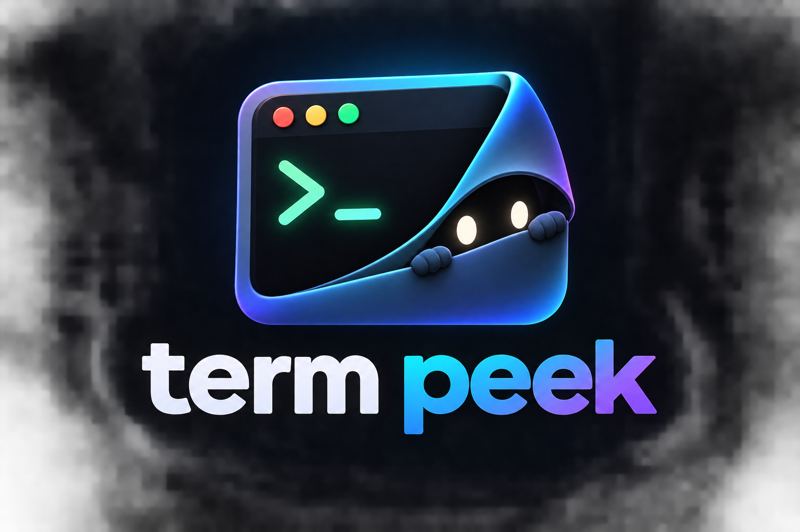

<p align="center">
  
</p>

# termpeek 2.0

Intelligent dual-layer type-ahead command assistance and live pre-flight inspection for Zsh.

When typing commands in your terminal, Termpeek provides instantaneous native inline completions without screen flicker or terminal row corruption. Pressing `Tab` or `Ctrl+Space` summons the **Live Pre-Flight Inspector**: a transient HUD that audits port collisions, git synchronization status, and destructive blast radius before you press Enter.

## Dual-Layer Architecture

Traditional shell plugins either manipulate out-of-band VT100 cursor escapes (which fight ZLE internal 2D line wrapping buffers and corrupt prompts) or take over the entire terminal with intrusive full-screen TUIs.

`termpeek 2.0` solves this with a clean dual-layer architecture:

1. **Layer 1: Native ZLE Inline Ghost Completion (Keystroke Path)**:
   - Emits **zero** ANSI cursor movement escapes (`\e7`, `\e8`, `\e[B`, `\e[A`) to `stderr`.
   - Populates native ZLE `POSTDISPLAY` with syntax-highlighted ghost text (`fg=8,underline`).
   - Line wrapping across `$COLUMNS`, multi-line paths, and backspacing are 100% handled by the terminal's native screen buffer.
   - Keystroke latency is sub-1ms with 0 subprocess forks.

2. **Layer 2: Sandboxed Alternate-Screen Pre-Flight HUD (Inspection Path)**:
   - Summons on demand via `Ctrl+Space`, `Alt+P`, or `Down Arrow`.
   - Runs exclusively on the terminal alternate screen buffer (`\e[?1049h\e[?25l`), freezing the main terminal canvas and scrollback.
   - Renders an interactive inspection card showing prompt reflection, numbered Markov completions, and live environment diagnostics.
   - Exits cleanly with `\e[?1049l\e[?25h` and `zle reset-prompt`. Failsafe traps and `always` blocks guarantee zero terminal lockups and healthy TTY state under any interruption.

3. **Persistent Asynchronous Background Worker**:
   - A warm Python daemon processes history scoring, dual-stack socket availability, and filesystem metrics off the main thread over non-blocking Unix FIFOs.

## Developer Features

`termpeek 2.0` introduces features built specifically for daily engineering workflows:

- **Live Port Collision Pre-Flight (`Alt+K` Instant Kill)**:
   - When typing dev server commands (`xlan`, `npm run dev`, `vite`, `expo start`, `artisan serve`, or commands with `:PORT`), Termpeek probes `127.0.0.1:<port>` and `[::1]:<port>` in under 0.08ms via non-blocking TCP socket connect.
   - If a port is occupied by an orphaned background process, the HUD displays `⚠️ [Port <port> LOCKED by <process> (PID <pid>) - Press Alt+K to kill process]`.
   - Pressing `Alt+K` sends `SIGTERM` to the conflicting process immediately, freeing the port without leaving your shell.

- **Destructive Command Blast-Radius Audit (`[DANGER]`)**:
   - High-risk operations (such as `rm -rf`, `git reset --hard`, `git clean -fd`, `docker system prune`) are audited in real time.
   - Termpeek evaluates target path scope and calculates affected file counts and byte size (`⚠️ [BLAST RADIUS: 142+ files (12.4 MB) in 'build' will be deleted]`).
   - Destructive suggestions are safely loaded to your prompt line with a review notice before execution.

- **Zero-Fork Git Worktree Inspection**:
   - Direct file inspection of `.git/HEAD`, loose refs, `.git/packed-refs`, and worktree pointer files checks whether your local branch has diverged from origin without spawning slow `git` subprocesses.

- **Screen-Share Privacy & Secret Sanitization (`[SECRET]`)**:
   - When sharing your screen, pairing, or recording, typing keywords will never leak sensitive credentials. API keys (OpenAI, Anthropic, GitHub, AWS, Stripe), Bearer tokens, and passwords found in history are automatically masked in the preview (`sk-...****[REDACTED]`).

- **Project Task Discovery (`[project]`)**:
   - In any project directory, Termpeek reads `package.json`, `Makefile`, `Cargo.toml`, `docker-compose.yml`, or `pyproject.toml`. Typing `test`, `dev`, `build`, or `run` surfaces repository scripts directly.

- **Token-Aware Markov-Frecency Ranking**:
   - First-order Markov chain transitions predict sequential workflows (e.g. `npm test` after `git commit`) blended with exponential time decay and directory affinity.

## Controls

| Key | State | Action |
| :--- | :--- | :--- |
| **Type (2+ chars)** | Any | Shows instant inline ghost completion (`POSTDISPLAY`) |
| **Right Arrow (`→`) / Ctrl+F** | Ghost text visible | Accepts inline ghost completion into prompt |
| **Tab** | Ghost text visible | Accepts inline ghost completion (or standard completion) |
| **Ctrl+Space / Alt+P** | Any | Opens Layer 2 Pre-Flight Inspector HUD |
| **Down Arrow (`↓`)** | At prompt with matches | Opens Layer 2 Pre-Flight Inspector HUD |
| **Up / Down (`↑`/`↓`)** | Inside HUD | Navigates candidate completions |
| **Alt+K** | Inside HUD (Port collision) | Sends `SIGTERM` to locking PID and frees port |
| **Enter / Tab / Right Arrow** | Inside HUD | Fills prompt with highlighted command and exits HUD |
| **Escape / Ctrl+C / q** | Inside HUD | Exits HUD and returns to prompt cleanly |
| **Enter** | Prompt line | Executes prompt command (prompts review if dangerous) |
| **Ctrl+C (`^C`)** | Prompt line | Native shell `SIGINT` aborts command line cleanly |

## Configuration

You can customize `termpeek` by setting these environment variables in your `~/.zshrc` before sourcing the script:

```bash
# Maximum number of suggestions to display (default: 4)
export TERMPEEK_MAX_RESULTS=4

# Selection pointer icon (default: ▶)
export TERMPEEK_POINTER="▶"

# Show navigation hints next to suggestions (1 = show, 0 = hide, default: 1)
export TERMPEEK_SHOW_HINTS=1

# Only suggest commands that succeeded with exit code 0 or -1 (default: 1)
export TERMPEEK_ONLY_SUCCESSFUL=1

# Show built-in recipe cheatsheets when history has few matches (default: 1)
export TERMPEEK_RECIPES=1

# Discover local project tasks from package.json, Makefile, Cargo.toml, etc. (default: 1)
export TERMPEEK_PROJECT_TASKS=1

# Flag destructive commands with [DANGER] and require confirmation (default: 1)
export TERMPEEK_SAFETY_GUARD=1

# Mask API keys and secrets in suggestion display for screen-share privacy (default: 1)
export TERMPEEK_MASK_SECRETS=1
```

## Installation

### Manual

Clone this repository:

```bash
git clone https://github.com/zerakjamil/termpeek.git ~/.termpeek
```

Add this line to your `~/.zshrc`:

```bash
source ~/.termpeek/termpeek.zsh
```

Then reload your shell:

```bash
exec zsh
```

### Oh My Zsh

1. Clone into your custom plugins directory:
   ```bash
   git clone https://github.com/zerakjamil/termpeek.git ${ZSH_CUSTOM:-~/.oh-my-zsh/custom}/plugins/termpeek
   ```
2. Add `termpeek` to the plugins list in your `~/.zshrc`:
   ```bash
   plugins=(... termpeek)
   ```

### Zinit

Add this to your `~/.zshrc`:

```bash
zinit light zerakjamil/termpeek
```

## Platforms supported

`termpeek` runs universally on any POSIX terminal environment with Zsh and Python 3:

- **macOS**: Terminal.app, iTerm2, Alacritty, Kitty, WezTerm, Ghostty (Intel & Apple Silicon).
- **Linux**: Ubuntu, Debian, Arch Linux, Fedora, Alpine, NixOS, Void, and all standard distros across GNOME Terminal, Konsole, foot, etc.
- **Android / Termux**: Native support on mobile phones and tablets. Adapts automatically to small portrait screens (down to 30 columns) and dynamic height adjustments when the on-screen soft keyboard opens or closes (`SIGWINCH`).
- **Windows**: Windows Subsystem for Linux (WSL), MSYS2, Git Bash, Cygwin, and Windows Terminal.
- **Multiplexers & SSH**: tmux, screen, and remote SSH sessions.

### Installing on Termux (Android)

In Termux on your phone or tablet:

```bash
# 1. Install prerequisites
pkg update && pkg install zsh python git

# 2. Clone termpeek
git clone https://github.com/zerakjamil/termpeek.git ~/.termpeek

# 3. Add to ~/.zshrc
echo "source ~/.termpeek/termpeek.zsh" >> ~/.zshrc

# 4. Launch Zsh
exec zsh
```

## History backends

`termpeek` works out of the box with standard Zsh history (`~/.zsh_history`) and Bash history (`~/.bash_history`). No database setup is required.

If you also use [Atuin](https://github.com/atuinsh/atuin), `termpeek` automatically detects its SQLite database (`~/.local/share/atuin/history.db`) for directory-scoped scoring, exit-code filtering, and sub-millisecond lookups across all terminal tabs.

## Verification suite

`termpeek` includes an automated headless PTY verification harness to validate zero-fork execution, sub-3ms latency, and clean screen restoration:

```bash
# Run headless PTY integration suite (latency benchmark, zero-fork audit, signal lifecycle)
./tests/test_harness.py

# Run widget state machine unit tests
./tests/test_termpeek.zsh
```

## License

MIT
